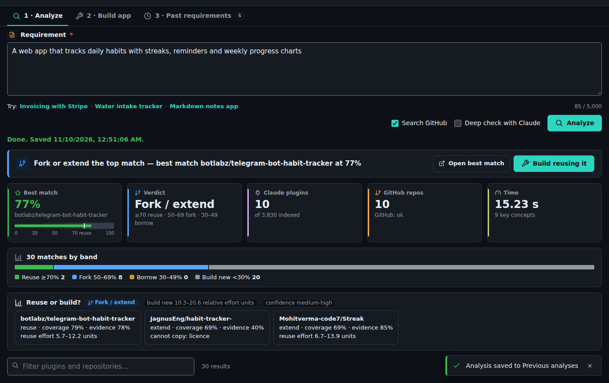
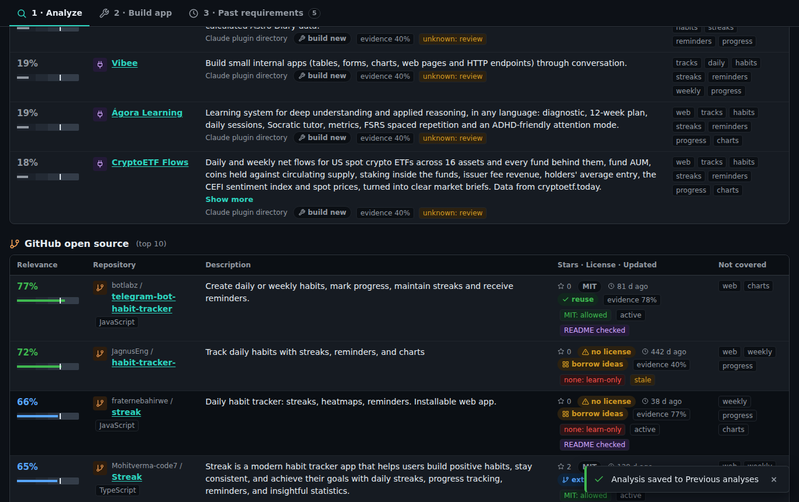

# ReuseFirst — Reuse-First Builder

**Before you build it, find out whether it already exists.** ReuseFirst is a Claude Code plugin with a local web UI.
For any requirement it finds the closest existing Claude Code plugins, GitHub projects and npm / crates.io packages,
tells you whether reusing one is actually better than building new, and then builds or enhances the app for you to
your engineering and UI standards.

**Try the analysis now:** [ReuseFirst on Agensi](https://www.agensi.io/skills/reusefirst) — works in Claude Code,
Cursor, Codex CLI and 20+ other agents. No install, no API key.

## Features

### Reuse analysis
- Searches **~3,800 Claude Code plugins**, **GitHub repositories**, and the **npm** and **crates.io** registries.
- Every candidate gets a relevance score, concept coverage (and the concepts it misses), evidence confidence,
  licence class, language compatibility, maintenance state, and a recommendation: *reuse*, *extend*, *borrow*,
  *build new* or *insufficient evidence*.
- A **decision panel** compares reuse and build-new effort ranges, with assumptions and sensitivity.
- Optional **deep check with Claude**: a semantic review of the top candidates.
- Exportable decision report, and a history of past requirements.

### Build or enhance apps
- **List required inputs:** Claude pre-fills every input the build needs (users, journeys, MoSCoW features,
  Given/When/Then acceptance criteria, non-functional targets, reuse picks). You review them and set a spending cap
  and time limit.
- Reuse picks are cloned at a pinned commit, licence-checked and recorded with provenance.
- Claude Code builds headless **inside a sandbox**: only the app folder is writable, and the network reaches only
  the Claude API and package registries.
- New apps always get a **free port** that no other app uses.
- **Independent verification:** ReuseFirst re-runs the tests itself and checks syntax, secrets, known
  vulnerabilities, SBOM, provenance and start-up. A build is *succeeded* only when every mandatory check passes.
- **Enhancements** work on a staging copy and replace the app only when everything passes.
- **Launch app** runs a verified app in the sandbox with a health check and a Stop button.

## Source code
The source code is private. For access, collaboration or questions, contact **buildsbeyondai@gmail.com**.

---
© 2026 Jude Finney. All rights reserved. Claude and Claude Code are trademarks of Anthropic; this project is not
affiliated with or endorsed by Anthropic.
